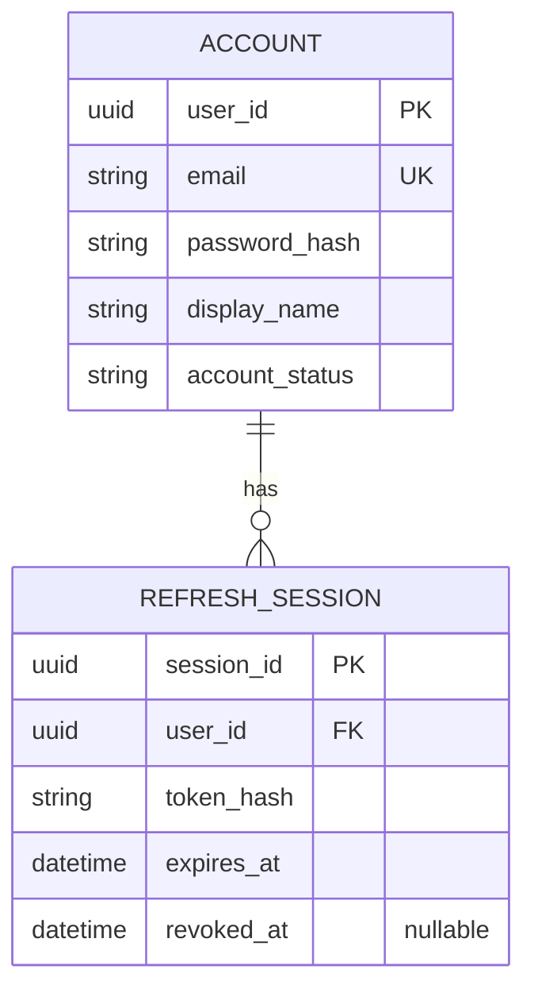
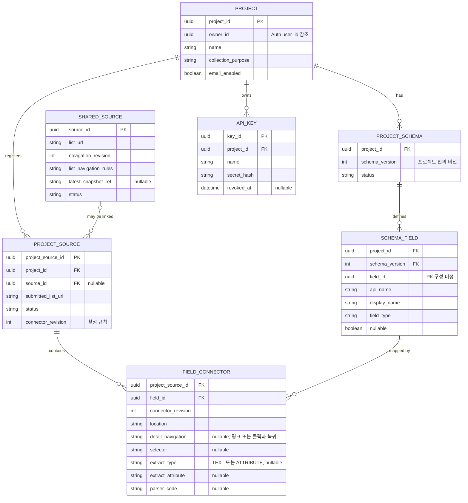
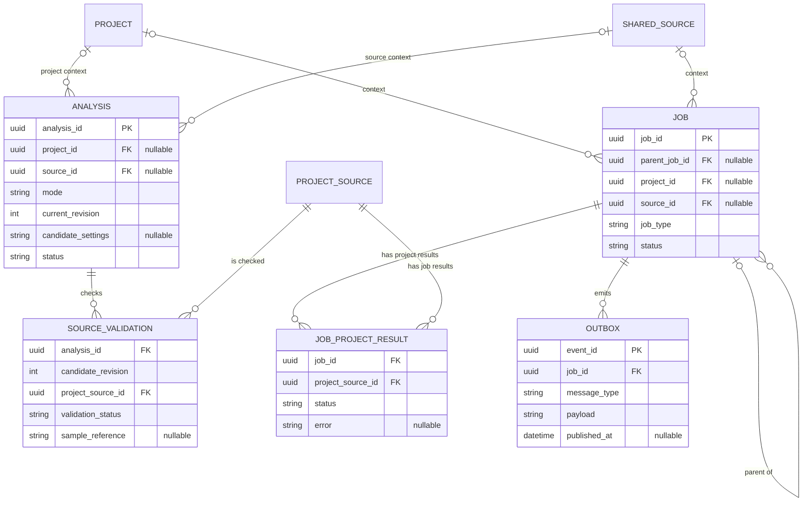
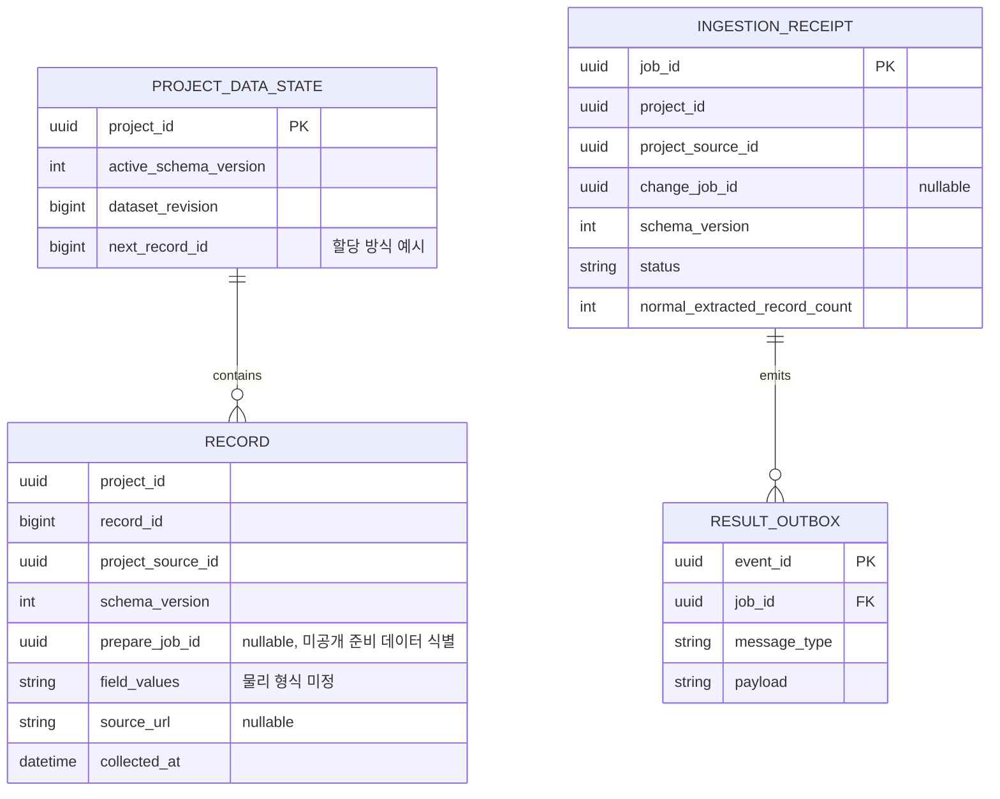

# Weavo ERD 초안

- 상태: **논리 설계 초안**. 테이블·컬럼 이름과 실제 물리 저장 방식은 확정 전이다. 이 문서는 Flyway SQL이나 JPA 엔티티를 생성하지 않는다.
- 기준: [스펙 결정 로그](spec-decision-log.md), [서비스 메시지 명세](service-message-contracts.md), [메시지 흐름](service-message-flows.md). 서비스 간 메시지 계약이 충돌하면 메시지 명세를 우선한다.
- 읽는 법: ERD는 데이터가 어떤 관계에 있는지 보여 주는 **논리적 표현**이다. `분석_후보`, `준비_결과`처럼 별도 실체로 표시한 항목이 반드시 별도 물리 테이블이어야 한다는 뜻은 아니다. 아래의 제안과 미정 사항을 함께 검토해야 한다.
- 이 문서는 서비스별 데이터 소유와 업무 관계를 먼저 정리한다. 세부 타입·인덱스·삭제 방식·트랜잭션을 승인한 최종 설계로 취급하지 않는다.

## 1. 데이터 소유와 저장 위치

| 데이터 | 소유·관리 주체 | 저장 위치 | 다른 서비스와의 관계 |
| --- | --- | --- | --- |
| 사용자 계정·영구 인증 정보 | Auth | `weavo_auth` | Control은 소유자 ID를 참조한다. 서로 다른 DB이므로 DB 외래 키는 없다. |
| 이메일 인증번호·인증 완료의 임시 상태 | Auth | Redis | 가입·비밀번호 초기화 시 이메일과 목적에 맞춰 확인한다. 영구 계정 데이터는 RDS에 둔다. |
| 프로젝트·출처·스키마·커넥터·분석 후보·작업 | Control | `weavo_control` | Analysis·Crawler는 요청받은 설정을 사용하고 결과를 Control에 보낸다. |
| 수집 데이터·공개 상태·적재 결과 | Ingestion 관리, Data 조회 | `weavo_data` | 프로젝트·출처 ID를 Control에서 전달받아 사용한다. DB 간 외래 키는 없다. |
| 분석 샘플·중간 후보·HTML/DOM 스냅샷 | Analysis 또는 Crawler가 생성 | S3 | DB에는 필요한 식별자·객체 참조·상태를 저장한다. 분석 샘플과 수집 스냅샷은 별도 객체다. |
| 정기 스케줄 | Control이 관리 | EventBridge Scheduler 및 필요한 Control 메타데이터 | Scheduler는 고정된 source_id와 예정 시각을 전송한다. 프로젝트와 최신값은 Control이 조회한다. |
| 큐 메시지 | 각 서비스가 처리 | SQS | DB에는 모든 메시지의 복사본이 아니라 필요한 작업 상태, 발행·수신 이력 등을 둔다. |

현재 로컬 환경은 PostgreSQL 인스턴스 하나에 위 DB 세 개를 둔다. DB의 논리적 분리가 RDS 인스턴스 세 개를 뜻하지는 않는다. Analysis·Crawler는 별도 업무용 DB를 소유하지 않는 현재 구조를 따른다.

### DB를 가로지르는 식별자

- `owner_id`: Control의 프로젝트가 Auth 사용자 ID를 참조한다. Control이 JWT와 내부 권한 확인 절차를 통해 검증한다. 이 ID만으로 인증을 대체하지 않는다.
- `project_id`, `project_source_id`: Ingestion이 Control의 소유 식별자를 메시지로 전달받아 `weavo_data` 레코드에 기록한다. source_id는 수집·메시지의 공유 출처 식별자이며 레코드에 중복 저장하지 않는다. 이름이 같아도 DB 간 FK가 아니다.
- 서비스 간 삭제·지연 결과는 메시지·작업 상태와 쓰기 검증으로 처리해야 하므로 FK의 자동 삭제에 의존하지 않는다.

## 2. 전체 관계 개요

```text
Auth DB                         Control DB                        Data DB
[사용자] -- owner_id 참조 --> [프로젝트] -- project_id 참조 --> [공개 데이터 상태]
                                  │                                  │
                                  ├─ [프로젝트 출처] ─ source_id ─┐  ├─ [적재 작업 결과]
                                  │       │                      │  └─ [수집 레코드]
                                  │       └─ [필드 커넥터]        │
                                  ├─ [스키마] ─ [스키마 필드]    │
                                  └─ [분석/작업/메시지 처리]     │
                                                                │
                           [공유 출처] <─────────────────────────┘
                                  │
                              S3 스냅샷 참조
```

화살표는 업무상 참조다. Auth·Control·Data 사이에는 물리 FK를 만들지 않는다. 아래의 Mermaid ERD는 각 DB 내부만 나타낸다.

## 3. Auth: 계정과 인증



| 논리 항목 | 역할과 검토 사항 |
| --- | --- |
| `ACCOUNT` | 로그인 계정의 소유자 ID, 이메일, 비밀번호 해시와 사용자 정보를 보관한다. 비밀번호 원문은 저장하지 않는다. |
| `REFRESH_SESSION` | refresh 토큰 회전·폐기를 위한 세션 표현 후보. 토큰 원문이 아닌 검증 가능한 값 보관을 고려한다. 실제 토큰 저장·해시·CSRF 설계는 확정 전이다. |
### 이메일 인증 상태: Redis

이메일 인증번호와 인증 완료 상태는 **RDS 테이블을 만들지 않고 Redis의 만료되는 임시 상태**로 관리한다. 회원가입 전에는 계정이 존재하지 않을 수 있으므로 이메일과 인증 목적을 기준으로 구분한다. Redis의 구체적인 키·값 구조는 예시이며 구현 시 결정한다.

```text
인증번호 발급 → Redis에 해당 이메일·목적의 검증 정보와 만료시간 저장 → 메일 발송
인증번호 확인 → 성공 시 같은 이메일·목적의 인증 완료 상태 기록
회원가입/비밀번호 초기화 → 인증 완료 상태 확인 → 해당 작업 완료 후 사용 처리
```

- 회원가입과 비밀번호 초기화는 별도 인증 목적이다. 한 목적의 인증을 다른 목적에 사용하지 않는다.
- 인증번호 검증과 사용 여부의 동시 처리에서 중복 이용을 막아야 한다. Redis 상태와 RDS 계정 변경은 서로 다른 저장소이므로 계정 생성 실패·재시도 시 인증 상태를 어떻게 보존·소비할지는 별도 설계한다.
- 재발송 시 이전 번호 무효화, 인증번호·인증 완료 상태의 유효 시간, 시도 제한 및 저장 형식은 미정이다. 인증번호 원문·인증 토큰을 로그에 남기지 않는다.
- Redis 상태가 유실되거나 Redis에 접근할 수 없다면 인증 성공으로 간주하지 않는다. 저장소 복구 또는 재인증으로 이어진다. 영구 계정 정보는 `weavo_auth`에 남는다.
- `REFRESH_SESSION`의 저장 위치와 수명은 이 결정으로 정해지지 않는다.

## 4. Control: 프로젝트·공유 출처·스키마



### 핵심 관계

1. **프로젝트와 공유 출처:** `PROJECT_SOURCE`는 하나의 프로젝트와 공유 출처를 연결한다. 분석 전 `source_id`는 null일 수 있다. 공유 출처는 URL과 목록 범위·초기 조건·목록 이동 방식으로 판정한다.
2. **스키마와 필드:** 프로젝트별 `(project_id, schema_version)`에 해당 버전의 `SCHEMA_FIELD`를 연결한다. 필드 커넥터도 같은 프로젝트의 정확한 필드 버전을 참조한다. 버전 간 필드 ID 유지는 필수가 아니다.
3. **필드 커넥터:** 별도 프로젝트 커넥터 테이블 없이 `PROJECT_SOURCE` 아래 필드별 규칙을 둔다. 활성 `connector_revision`과 실행 중인 새 버전의 규칙을 구분해 준비 중 기존 규칙을 덮어쓰지 않는다. 후보는 분석에 보관한다.
4. **상세와 목록 규칙:** 공유 목록 이동은 `SHARED_SOURCE`, 상세 이동·복귀·CSS·추출·파싱은 `FIELD_CONNECTOR`에 둔다. 실행 중 동일한 상세 동작을 묶어 한 번 방문하고 목록 항목 및 프로젝트·필드에 연결한다.
5. **스냅샷:** 공유 출처에 최신 정상 참조를 두고 작업별 불변 객체 참조는 해당 작업 결과에 둔다. 참조 중인 객체는 적재·재처리가 종료된 뒤 정리한다. 별도 이력 테이블을 전제하지 않는다.
6. **API 키:** 프로젝트별 키의 원문 대신 검증 가능한 해시와 폐기 상태를 저장한다.

### 명시적으로 남겨둔 제약

- 공유 출처는 **URL만으로 유일하지 않다**. 목록 범위·초기 조건·이동 방식까지 같아야 하며, 규칙의 실제 비교 표현은 미정이다. `list_url`에 단독 유일 제약을 두지 않는다.
- 공통 스키마와 필드 위치·CSS 선택자의 사용자 수정은 활성 설정을 즉시 덮어쓰지 않는다. 후보 스키마·커넥터와 현재 활성 필드 커넥터를 논리적으로 구분하고, 승인 가능한 후보 revision과 검증 결과를 연결해야 한다. 실제 저장 방식은 미정이다.
- 기존 커넥터의 전체 과거 이력이나 롤백을 무제한 저장하는 정책은 없다. revision, 변경 시각·원인과 현재 활성 규칙에 대한 기존 정책을 따른다.

## 5. Control: 분석·작업·메시지



| 논리 항목 | 역할 |
| --- | --- |
| `ANALYSIS` | 초기·스키마 수정·출처 추가 등의 분석 단위를 식별하고 현재 후보 revision과 상태를 관리한다. `analysis_id`와 개별 작업 `job_id`는 다르다. 공유 출처 복구는 source_id와 프로젝트별 검증 대상을 사용한다. |
| 분석 후보 | 현재 후보를 `ANALYSIS`에 보관한다. revision별 전체 이력은 전제하지 않으며 사용자 수정과 검증 상태를 원자적으로 관리한다. |
| `SOURCE_VALIDATION` | 어느 후보 revision을 어느 출처에서 검증했는지, 통과 여부와 S3 샘플 참조를 표현한다. 샘플 원문은 S3에 있다. 별도 `validation_id`는 전제하지 않는다. |
| `JOB_PROJECT_RESULT` | `(job_id, project_source_id)` 기준 프로젝트 출처별 결과. 수집과 적재는 각 단계의 별도 job_id로 구분한다. |
| `JOB` | 분석·수집·적재·준비·삭제 등 Control의 작업 원장. 공유 출처 작업은 project_id 없이 source_id를 가질 수 있고, project 작업은 source_id 없이 존재할 수 있다. 부모 작업과 자식 작업을 구분한다. |
| `OUTBOX` | 업무 상태와 함께 트랜잭션으로 기록한 뒤 SQS로 발행할 메시지. 내부 구현 세부는 제안이며 메시지별 송신처와 재발행 규칙을 반영해야 한다. |
| 수신 이벤트 처리 기록 | `event_id` 중복 확인과 job별 결과 채택을 위한 **논리 항목**. 구체 테이블과 보관 기간은 미정이므로 그림에는 별도 엔터티를 고정하지 않았다. |

- 동일한 후보 revision에서도 출처별 검증 결과를 구분해야 한다. 승인 요청 revision, 현재 후보, 필요한 출처의 검증 revision을 대조한다. 검증 ID를 새로 만들지 않는다.
- Control이 자식 작업을 미리 식별하고 해당 작업 집합의 결과를 집계해야 중복 이벤트가 완료 건수를 부풀리지 않는다. 상태 변경·수신 이력·후속 작업·Outbox의 트랜잭션 경계를 별도로 검토한다.
- 이 그림은 **프로젝트 밖에서 생성될 수 있는 공유 출처 작업**을 허용한다. `JOB.project_id`를 무조건 필수로 두지 않는다. 정확한 작업별 필수 FK·상태 전이는 메시지 타입에 따라 결정한다.

## 6. Data: 공개 버전과 적재 결과



- **RECORD:** 한 테이블에 저장하며 `project_id`, `project_source_id`, `schema_version`을 보관한다. 공유 `source_id`는 레코드에 중복하지 않는다. `(project_id, record_id)`로 식별하며 필드값의 물리 형식은 미정이다.
- **공개 버전:** Data는 `PROJECT_DATA_STATE.active_schema_version`과 레코드 버전을 대조해 조회한다. 새 스키마 데이터는 버전 전환 전 조회되지 않는다. 새 버전으로 전환하기 전 해당 버전의 필드 정의도 Data 조회 경로에서 이용 가능해야 한다. 데이터와 공개 스키마 조회는 동일한 공개 버전을 기준으로 한다.
- **준비와 재시도:** 미공개 레코드의 `prepare_job_id`로 출처별 준비 작업을 구분한다. 실패한 준비 작업의 부분 데이터는 트랜잭션 롤백 또는 해당 작업 기준 정리 후 재시도한다. 취소·실패의 미공개 데이터는 정리하며, 성공한 다른 준비는 유지할 수 있다. 새 승인 변경은 이전 미공개 결과를 무심코 재사용하지 않는다.
- **INGESTION_RECEIPT:** job_id 기준 중복 처리와 준비 결과를 기록한다. 별도 `DATASET`, `PREPARED_RESULT` 테이블이나 새 식별자는 전제하지 않는다.
- **RESULT_OUTBOX:** 데이터 변경·완료 기록과 같은 트랜잭션에 결과 발행을 기록한다.

### 사용자 정의 필드 저장은 아직 결정하지 않음

| 방식 | 장점 | 검토할 점 |
| --- | --- | --- |
| PostgreSQL `JSONB` 한 컬럼에 필드값 저장 | 프로젝트마다 필드가 달라도 테이블 구조가 단순하다. | number·date·boolean 등 **타입별 필터·정렬·커서**와 인덱스, 누락·실제 null·실패 구분을 설계해야 한다. |
| 필드별 값 행으로 정규화 | 필드 단위 조회와 타입별 값·검증 정보를 다루기 쉽다. | 레코드 조회 시 행과 조인이 늘고 다중 필드 정렬·필터가 복잡해질 수 있다. |
| 프로젝트별 동적 테이블 | 일반 컬럼처럼 타입별 조회·인덱스를 적용할 수 있다. | 프로젝트·버전별 DDL, 권한, 스키마 변경과 운영 관리의 복잡도가 커진다. |

**검토 방향:** 우선 JSONB 기반 시안을 구체적인 데이터와 필터 예시로 시험해보되, 스펙은 JSONB를 확정하지 않았다. 어떤 방식이든 서로 다른 필드값이면 새 레코드로 판단하고, 동일 필드값의 중복 확인에서 해시를 사용하더라도 충돌에 대비해 실제 값을 검증해야 한다. 비교 정규화와 일부 실패 레코드의 저장 기준은 미정이다.

### 리비전·레코드 번호에서 주의할 점

- `schema_version`: 공개 API의 필드 구조 버전. `dataset_revision`: 공개 데이터 상태 변경을 나타내며 서로 다른 값이다.
- 리비전 수집의 출처 중 하나라도 실패하거나 정상 결과가 0건이면 전체 교체를 보류하고 이전 데이터와 API를 유지한다. 0건 알림과 복구 가능한 오류의 알림 시점은 각 정책을 따른다.
- DB 마이그레이션 도구 Flyway의 버전과 사용자 스키마 리비전은 다르다. Flyway는 Weavo 테이블 구조를 관리하며, 사용자 스키마 리비전은 새 데이터를 수집·준비한 후 공개 상태를 교체하는 제품 흐름이다.
- 프로젝트별 `record_id`를 동시 적재에서 유일하게 발급하고 실패·재시도·삭제 후에도 재사용하지 않도록 할당 방식을 별도 검증한다. 그림의 `next_record_id`는 제안이지 구현 결정이 아니다.

## 7. 시나리오로 검토

| 상황 | 초안에서 확인할 관계와 동작 | 남은 질문 |
| --- | --- | --- |
| 두 프로젝트가 같은 목록을 사용 | 각 프로젝트의 `PROJECT_SOURCE`가 하나의 `SHARED_SOURCE`를 참조하고 수집 스냅샷은 공유한다. | 공유 출처 판정에서 목록 범위·초기 조건·이동 규칙을 어떻게 비교할까? |
| 같은 출처에서 프로젝트마다 다른 필드를 원함 | 각 `PROJECT_SOURCE` 아래 해당 프로젝트의 `SCHEMA_FIELD`별 `FIELD_CONNECTOR`를 둔다. | 목록 항목 경계 및 상세 이동 규칙의 저장 위치는? |
| 후보 수정 후 오래된 검증이 도착 | `analysis_id`와 candidate_revision·출처별 검증 상태를 대조한다. | 이전 후보·검증 결과를 물리적으로 얼마나 보관할까? |
| 사이트에 필드 추출 결과가 없음 | Crawler/Ingestion이 실패 단계·범위를 Control에 알리고 필요하면 Analysis가 후보를 검증한다. 실제 null과 실패는 구분한다. | 복구 시작 임계값, 부분 레코드 저장 기준은? |
| 스키마 변경 후 세 출처 중 하나가 실패 | Control이 전체 적용을 보류하고 Data는 기존 공개 상태를 유지한다. 준비된 다른 출처 결과는 적용 대기다. | 준비 데이터의 물리 저장·정리와 데이터/버전 포인터 소유권은? |
| 프로젝트에서 공유 출처 하나를 제거 | 해당 프로젝트의 연결과 데이터만 정리하고 다른 프로젝트의 연결은 유지한다. | DB 간 비동기 삭제 완료 상태와 지연 작업 차단은 어떻게 보장할까? |
| 수집·적재 결과가 중복 전달 | Control은 event_id와 job 결과 채택을 검사하고 Ingestion은 job_id receipt와 트랜잭션으로 중복 반영을 막는다. | 보관 기간·동시 실행·기한 종료 후 결과 차단의 구체 구현은? |

## 8. 다음에 결정할 항목

1. **사용자 필드값의 물리 저장:** JSONB·필드값 행·동적 테이블 중 방식, 필터·정렬·인덱스와 null·실패 표현.
2. **스키마·필드 버전:** 스키마의 PK/UK와 커넥터가 정확한 필드 버전 및 같은 프로젝트에 연결되는 제약을 결정한다. 버전 간 field_id 유지는 필수가 아니다.
3. **후보·검증 보관:** 후보 revision과 출처별 상태의 물리 테이블/JSON 구성, 검증 결과와 샘플 참조의 보관 범위.
4. **상세·목록 탐색 규칙:** 목록 항목 경계와 같은 URL의 공유 출처 판정 표현. 상세 이동·복귀 규칙은 필드 커넥터에 둔다.
5. **데이터 세트 교체와 record_id 발급:** 작업별 미공개 데이터 정리, 공개 버전·스키마 읽기 일관성, 프로젝트별 순차 발급과 중복 요청 처리.
6. **인증·비동기 운영:** 이메일 인증은 Redis 임시 상태로 두되 인증번호·인증 완료 상태의 수명과 시도 제한·재발송·RDS 처리 실패 시 소비 방식은 미정이다. refresh 저장 위치·수명과 Outbox·수신 기록·receipt의 테이블·보관 기간도 미정이다.

이 항목들을 결정한 다음 컬럼별 타입·PK/FK·고유 제약·인덱스·삭제 정책을 구체화하고, 초기 테이블부터 각 DB 소유 서비스의 Flyway SQL과 JPA 엔티티로 옮긴다.
