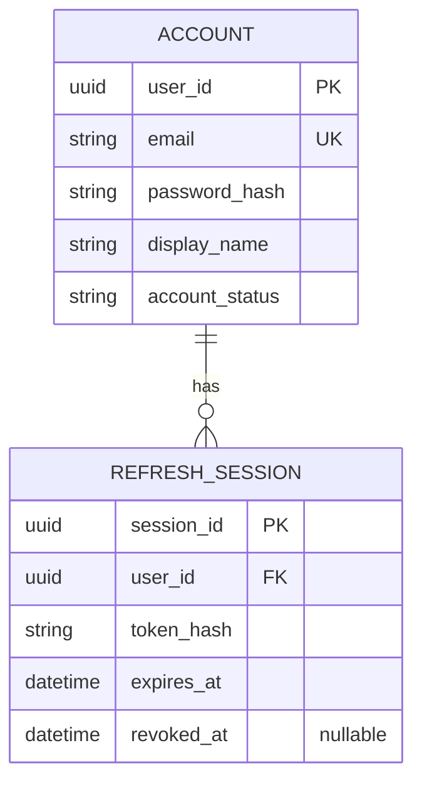
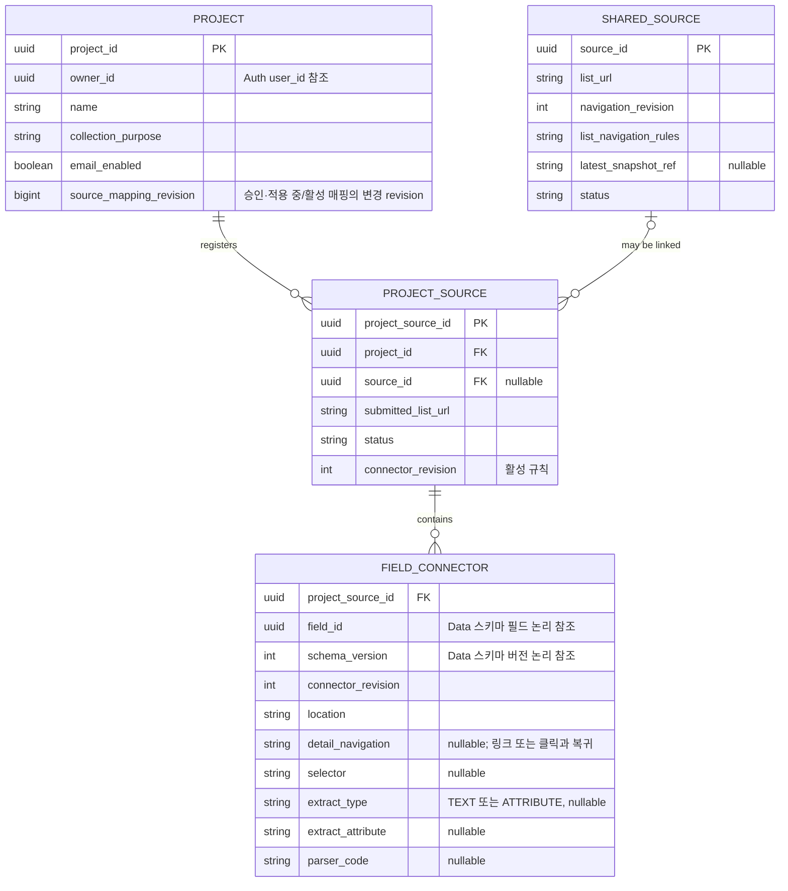
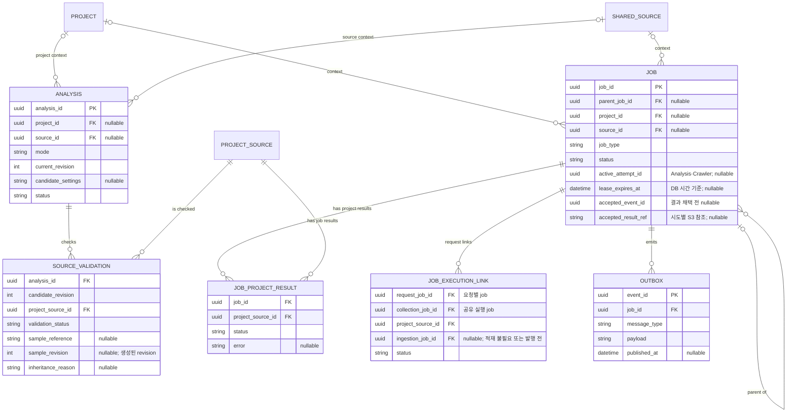

# Weavo ERD 초안

- 상태: **논리 설계 초안**. 테이블·컬럼 이름과 실제 물리 저장 방식은 확정 전이다. 이 문서는 Flyway SQL이나 JPA 엔티티를 생성하지 않는다.
- 기준: [스펙 결정 로그](spec-decision-log.md), [서비스 메시지 명세](service-message-contracts.md), [메시지 흐름](service-message-flows.md). 서비스 간 메시지 계약이 충돌하면 메시지 명세를 우선한다.
- 읽는 법: ERD는 데이터가 어떤 관계에 있는지 보여 주는 **논리적 표현**이다. `분석_후보`, `준비_결과`처럼 별도 실체로 표시한 항목이 반드시 별도 물리 테이블이어야 한다는 뜻은 아니다. 아래의 제안과 미정 사항을 함께 검토해야 한다.
- 이 문서는 서비스별 데이터 소유와 업무 관계를 먼저 정리한다. 세부 타입·인덱스·삭제 방식·트랜잭션을 승인한 최종 설계로 취급하지 않는다.

## 1. 데이터 소유와 저장 위치

| 데이터 | 소유·관리 주체 | 저장 위치 | 다른 서비스와의 관계 |
| --- | --- | --- | --- |
| 사용자 계정·영구 인증 정보 | Auth | `weavo_auth` | Control은 소유자 ID를 참조한다. 서로 다른 DB이므로 DB 외래 키는 없다. |
| 이메일 인증번호·인증 완료의 임시 상태 | Auth | Redis | 가입·비밀번호 초기화 시 이메일과 목적에 맞춰 확인한다. 영구 계정 데이터는 RDS에 둔다. |
| 프로젝트·출처·커넥터·스키마 후보·작업 | Control | `weavo_control` | Analysis·Crawler는 요청받은 설정을 사용하고 결과를 Control에 보낸다. |
| API 키 원본·해시·폐기 상태 | Data | `weavo_data` | project_id는 Control 프로젝트의 논리 참조이며 프로젝트 소유권·상태는 Control에서 확인한다. |
| 준비·공개 스키마 정의·수집 데이터·공개 상태·적재 결과 | Ingestion 관리, Data 조회 | `weavo_data` | 공개 스키마 원본은 Data DB에 둔다. 프로젝트·출처 ID는 Control에서 전달받으며 DB 간 외래 키는 없다. |
| 분석 샘플·중간 후보·HTML/DOM 스냅샷 | Analysis 또는 Crawler가 생성 | S3 | DB에는 필요한 식별자·객체 참조·상태를 저장한다. 분석 샘플과 수집 스냅샷은 별도 객체다. |
| 정기 스케줄 | Control이 관리 | EventBridge Scheduler 및 필요한 Control 메타데이터 | Scheduler는 고정된 source_id와 예정 시각을 전송한다. 프로젝트와 최신값은 Control이 조회한다. |
| 큐 메시지 | 각 서비스가 처리 | SQS | DB에는 모든 메시지의 복사본이 아니라 필요한 작업 상태, 발행·수신 이력 등을 둔다. |

현재 로컬 환경은 PostgreSQL 인스턴스 하나에 위 DB 세 개를 둔다. DB의 논리적 분리가 RDS 인스턴스 세 개를 뜻하지는 않는다. Analysis·Crawler는 별도 업무용 DB를 소유하지 않는 현재 구조를 따른다.

### DB를 가로지르는 식별자

- `owner_id`: Control의 프로젝트가 Auth 사용자 ID를 참조한다. Control이 JWT와 내부 권한 확인 절차를 통해 검증한다. 이 ID만으로 인증을 대체하지 않는다.
- `project_id`, `project_source_id`: Ingestion이 Control의 소유 식별자를 메시지로 전달받아 `weavo_data` 레코드에 기록한다. source_id는 수집·메시지의 공유 출처 식별자이며 레코드에 중복 저장하지 않는다. 이름이 같아도 DB 간 FK가 아니다.
- 서비스 간 삭제·지연 결과는 메시지·작업 상태와 쓰기 검증으로 처리해야 하므로 FK의 자동 삭제에 의존하지 않는다.

## 2. 전체 관계 개요

```text
Auth DB                         Control DB                        Data DB
[사용자] -- owner_id 참조 --> [프로젝트] -- project_id 참조 --> [공개 데이터 상태]
                                  │                                  │
                                  ├─ [프로젝트 출처] ─ source_id ─┐  ├─ [적재 작업 결과]
                                  │       │                      │  └─ [수집 레코드]
                                  │       └─ [필드 커넥터]        │
                                  ├─ [분석 후보 스키마]           ├─ [스키마] ─ [스키마 필드]
                                  └─ [분석/작업/메시지 처리]     │
                                                                │
                           [공유 출처] <─────────────────────────┘
                                  │
                              S3 스냅샷 참조
```

화살표는 업무상 참조다. Auth·Control·Data 사이에는 물리 FK를 만들지 않는다. 아래의 Mermaid ERD는 각 DB 내부만 나타낸다.

## 3. Auth: 계정과 인증



| 논리 항목 | 역할과 검토 사항 |
| --- | --- |
| `ACCOUNT` | 로그인 계정의 소유자 ID, 이메일, 비밀번호 해시와 사용자 정보를 보관한다. 비밀번호 원문은 저장하지 않는다. |
| `REFRESH_SESSION` | Auth DB에 refresh 토큰의 해시·만료·폐기 상태를 보관하고 원자적 회전과 폐기를 지원한다. 웹은 HttpOnly·Secure 쿠키와 세션에 결합된 CSRF 값을 사용한다. |
### 이메일 인증 상태: Redis

이메일 인증번호와 인증 완료 상태는 **RDS 테이블을 만들지 않고 Redis의 만료되는 임시 상태**로 관리한다. 회원가입 전에는 계정이 존재하지 않을 수 있으므로 이메일과 인증 목적을 기준으로 구분한다. Redis의 구체적인 키·값 구조는 예시이며 구현 시 결정한다.

```text
인증번호 발급 → Redis에 해당 이메일·목적의 검증 정보와 만료시간 저장 → 메일 발송
인증번호 확인 → 같은 이메일·목적에 묶인 일회용 증명 발급
회원가입/비밀번호 초기화 → 증명을 원자적으로 소비 → 계정 DB 작업
```

- 회원가입과 비밀번호 초기화는 별도 인증 목적이다. 한 목적의 인증을 다른 목적에 사용하지 않는다.
- 인증 증명은 계정 DB 작업 전에 Redis에서 원자적으로 소비한다. Redis와 RDS는 한 트랜잭션이 아니므로 DB 실패 또는 응답 유실로 결과를 확인할 수 없으면 재인증한다.
- 인증번호는 5분·최대 5회, 목적별 검증 성공 증명은 10분·일회용이다. 재발송은 이전 번호와 증명을 무효화한다. 인증번호 원문·인증 토큰을 로그에 남기지 않는다.
- Redis 상태가 유실되거나 Redis에 접근할 수 없다면 인증 성공으로 간주하지 않는다. 저장소 복구 또는 재인증으로 이어진다. 영구 계정 정보는 `weavo_auth`에 남는다.
- `REFRESH_SESSION`은 Auth DB에 보관하며 정확한 토큰 수명은 운영 설정이다. 비밀번호 초기화 시 비밀번호 변경과 모든 refresh 세션 폐기를 같은 Auth DB 트랜잭션에서 처리한다. 기존 access token은 만료까지 유효하다. 초기화와 로그인·refresh는 같은 계정 행 잠금으로 직렬화한다. 기기 ID는 필요하지 않다.

## 4. Control: 프로젝트·공유 출처·커넥터



### 핵심 관계

1. **프로젝트와 공유 출처:** `PROJECT_SOURCE`는 하나의 프로젝트와 공유 출처를 연결한다. 분석 전 `source_id`는 null일 수 있다. 공유 출처는 URL과 목록 범위·초기 조건·목록 이동 방식으로 판정한다.
2. **스키마와 필드:** 공개·적용 준비 스키마와 필드는 Data DB가 소유한다. Control의 필드 커넥터는 프로젝트·스키마 버전·필드 ID를 논리 참조하며 같은 프로젝트·버전인지 서비스 경계에서 검증한다. DB 간 물리 FK는 없다. 버전 간 필드 ID 유지는 필수가 아니다.
3. **필드 커넥터:** 별도 프로젝트 커넥터 테이블 없이 `PROJECT_SOURCE` 아래 필드별 규칙을 둔다. 활성 `connector_revision`과 실행 중인 새 버전의 규칙을 구분해 준비 중 기존 규칙을 덮어쓰지 않는다. 후보는 분석에 보관한다.
4. **상세와 목록 규칙:** 공유 목록 이동은 `SHARED_SOURCE`, 필드별 상세 열기 선택자·이동·복귀 및 상세 DOM의 값 추출 CSS·파싱은 `FIELD_CONNECTOR`에 둔다. 실행 중 동일한 상세 동작을 묶어 한 번 방문하고 목록 항목 및 프로젝트·필드에 연결한다.
5. **스냅샷:** 공유 출처에 최신 정상 참조를 두고 작업별 불변 객체 참조는 해당 작업 결과에 둔다. 참조 중인 객체는 적재·재처리가 종료된 뒤 정리한다. 별도 이력 테이블을 전제하지 않는다.

### 명시적으로 남겨둔 제약

- 공유 출처는 **URL만으로 유일하지 않다**. 목록 범위·초기 조건·이동 방식까지 같아야 하며, 정규화 설정의 정확 일치만 공유하고 애매하면 분리한다. Control이 비교·생성을 직렬화한다. `list_url`에 단독 유일 제약을 두지 않는다.
- 공통 스키마와 필드 위치·CSS 선택자의 사용자 수정은 활성 설정을 즉시 덮어쓰지 않는다. 후보 스키마·커넥터와 현재 활성 필드 커넥터를 논리적으로 구분하고, 승인 가능한 후보 revision과 검증 결과를 연결해야 한다. 실제 저장 방식은 미정이다.
- 기존 커넥터의 전체 과거 이력이나 롤백을 무제한 저장하는 정책은 없다. revision, 변경 시각·원인과 현재 활성 규칙에 대한 기존 정책을 따른다.

## 5. Control: 분석·작업·메시지



| 논리 항목 | 역할 |
| --- | --- |
| `ANALYSIS` | 초기·스키마 수정·출처 추가 등의 분석 단위를 식별하고 현재 후보 revision과 상태를 관리한다. `analysis_id`와 개별 작업 `job_id`는 다르다. 공유 출처 복구는 source_id와 프로젝트별 검증 대상을 사용한다. |
| 분석 후보 | 현재 후보를 `ANALYSIS`에 보관한다. revision별 전체 이력은 전제하지 않으며 사용자 수정과 검증 상태를 원자적으로 관리한다. |
| `SOURCE_VALIDATION` | 어느 후보 revision을 어느 출처에서 검증했는지, 통과 여부와 S3 샘플 참조·생성 revision·승계 근거를 표현한다. 분석의 출처별 중간 결과 참조는 후보 메타데이터에 보관한다. 샘플 원문은 S3에 있다. 별도 `validation_id`는 전제하지 않는다. |
| `JOB_EXECUTION_LINK` | 요청 job·공유 collection job·project_source_id와 필요 시 ingestion_job_id를 연결한다. 복합 유일 제약으로 중복을 막고 해당 적재 종료까지 요청별로 집계한다. 공유 실행은 여러 요청에서 참조할 수 있다. |
| `JOB_PROJECT_RESULT` | `(job_id, project_source_id)` 기준 프로젝트 출처별 결과. 수집과 적재는 각 단계의 별도 job_id로 구분한다. |
| `JOB` | 분석·수집·적재·준비·삭제 등 Control의 작업 원장. 공유 출처 작업은 project_id 없이 source_id를 가질 수 있고, project 작업은 source_id 없이 존재할 수 있다. 부모 작업과 자식 작업을 구분한다. |
| `OUTBOX` | 업무 상태와 함께 트랜잭션으로 기록한 뒤 SQS로 발행할 메시지. 내부 구현 세부는 제안이며 메시지별 송신처와 재발행 규칙을 반영해야 한다. |
| 수신 이벤트 처리 기록 | `event_id` 중복 확인과 job별 결과 채택을 위한 **논리 항목**. 구체 테이블과 보관 기간은 미정이므로 그림에는 별도 엔터티를 고정하지 않았다. |

- 동일한 후보 revision에서도 출처별 검증 결과를 구분해야 한다. 승인 요청 revision, 현재 후보, 필요한 출처의 검증 revision을 대조한다. 검증 ID를 새로 만들지 않는다.
- Control이 자식 작업 집합을 미리 식별하고 결과를 집계한다. Analysis·Crawler 결과의 유효 attempt·lease·revision 확인, 수신 이력·결과 채택·자식 작업·후속 Outbox를 같은 Control DB 트랜잭션으로 처리한다. accepted_result_ref는 채택 이후의 시도별 객체를 가리킨다. Ingestion은 Data DB의 receipt·쓰기·결과 Outbox를 별도 트랜잭션으로 관리한다.
- 이 그림은 **프로젝트 밖에서 생성될 수 있는 공유 출처 작업**을 허용한다. `JOB.project_id`를 무조건 필수로 두지 않는다. 정확한 작업별 필수 FK·상태 전이는 메시지 타입에 따라 결정한다.

## 6. Data: 공개 버전과 적재 결과

```mermaid
erDiagram
    PROJECT_DATA_STATE ||--o{ RECORD : "contains"
    PROJECT_SCHEMA ||--o{ SCHEMA_FIELD : "defines"
    INGESTION_RECEIPT ||--o{ RESULT_OUTBOX : "emits"
    PROJECT_DATA_STATE ||--o{ CHANGE_GUARD : "tracks"
    PROJECT_DATA_STATE ||--o{ SOURCE_WRITE_GUARD : "tracks"
    PROJECT_DATA_STATE o|--o{ API_KEY : "project context"

    PROJECT_SCHEMA {
        uuid project_id "Control 프로젝트 논리 참조"
        int schema_version
        string status "PREPARED 또는 PUBLISHED"
        uuid change_job_id "준비 작업 논리 참조; 최초 적용을 포함한 승인 상위 job_id"
    }
    SCHEMA_FIELD {
        uuid project_id
        int schema_version
        uuid field_id "PK 구성 미정"
        string api_name
        string display_name
        string description "nullable"
        int display_order
        string field_type
        boolean nullable
    }
    PROJECT_DATA_STATE {
        uuid project_id PK
        int active_schema_version "공개 전 null"
        bigint schema_metadata_revision "공개 스키마 표시 정보 revision"
        bigint dataset_revision
        string write_state "프로젝트 쓰기 차단·직렬화 상태"
        uuid open_change_job_id "nullable; 현재 열린 승인 변경"
    }
    RECORD {
        uuid project_id
        bigint record_id
        uuid project_source_id
        int schema_version
        uuid prepare_job_id "nullable, 미공개 준비 데이터 식별"
        jsonb field_values "field_id별 사용자 필드값"
        string source_url "직접 접근 가능한 항목 URL, nullable"
        datetime collected_at
    }
    CHANGE_GUARD {
        uuid project_id
        uuid change_job_id
        string change_type
        string status "OPEN 또는 CLOSED"
        string disposition "nullable; COMPLETED 또는 ABANDONED"
        int expected_schema_version "최초에는 nullable"
        int target_schema_version
        jsonb target_project_source_ids
        jsonb add_project_source_ids
        jsonb delete_project_source_ids
    }
    SOURCE_WRITE_GUARD {
        uuid project_id
        uuid project_source_id
        int active_schema_version "활성 출처만; nullable"
        int active_connector_revision "활성 출처만; nullable"
        datetime deleted_at "삭제 전 null; 삭제 후 차단 시각"
    }
    API_KEY {
        uuid key_id PK
        uuid project_id "Control 프로젝트 논리 참조"
        string name
        string secret_hash
        datetime revoked_at "nullable"
    }
    INGESTION_RECEIPT {
        uuid job_id PK
        uuid project_id
        uuid project_source_id "출처별 작업만; nullable"
        uuid change_job_id "nullable"
        int schema_version "작업에 해당할 때; nullable"
        string status
        string operation_or_mode "작업별 결과 구분"
        int connector_revision "적재 또는 준비 결과만; nullable"
        int normal_extracted_record_count "출처별 추출 결과만; nullable"
    }
    RESULT_OUTBOX {
        uuid event_id PK
        uuid job_id FK
        string message_type
        string payload
    }
```



- **API_KEY:** Data DB에 프로젝트 식별자·이름·키 검증 해시·폐기 상태를 보관한다. 프로젝트는 Control DB에 있으므로 물리 FK가 아니다. Data가 발급·폐기·검증하고 마지막 사용 시각은 Redis에서 조회한다. 위 관계는 논리 관계이고 물리 FK는 아니다. 발급 시 PROJECT_DATA_STATE가 없으면 project_id 유일 제약으로 생성·잠그며 삭제 차단 상태를 확인한다.
- **RECORD:** 한 테이블에 저장하며 `project_id`, `project_source_id`, `schema_version`을 보관한다. 공유 `source_id`는 레코드에 중복하지 않는다. `(project_id, record_id)`로 식별하며 필드값은 field_id를 키로 한 JSONB에 저장한다.
- **스키마와 공개 버전:** `PROJECT_SCHEMA`·`SCHEMA_FIELD`는 Data DB의 스키마 원본이다. Data는 `PROJECT_DATA_STATE.active_schema_version`을 기준으로 같은 버전의 필드 정의와 공개 레코드를 일관되게 읽는다. v2는 전환 전 공개하지 않는다. 최초 모든 출처 실패·0건이면 준비된 v1만으로 정상 운영 API를 공개하지 않고 확인 필요를 표시한다.
- **최초 부분 성공:** 최초 v1 수집은 정상 적재된 출처 데이터를 공개하고 실패·0건 출처는 Control에 문제로 표시한다. 최초 모든 출처가 실패하거나 정상 추출 0건이면 준비된 v1만으로 정상 운영 API를 공개하지 않고 확인 필요를 표시한다. 이후 한 출처라도 정상 적재되면 해당 성공 데이터를 공개한다. 공개 전 최초 복구는 공개 스키마 조회가 아니라 승인 v1 후보·커넥터와 승인 샘플을 적용 작업에서 확보한다. v2 구조 변경은 모든 최종 출처 성공 시 전체 전환한다.
- **준비와 재시도:** 미공개 레코드의 `prepare_job_id`로 출처별 준비 작업을 구분한다. 실패한 준비 작업의 부분 데이터는 트랜잭션 롤백 또는 해당 작업 기준 정리 후 재시도한다. 취소·실패의 미공개 데이터는 정리하며, 성공한 다른 준비는 유지할 수 있다. 새 승인 변경은 이전 미공개 결과를 무심코 재사용하지 않는다.
- **CHANGE_GUARD / SOURCE_WRITE_GUARD:** 기존 상위 change_job_id별 시작·종료 상태와 프로젝트 출처의 유효 스키마·커넥터 revision 및 삭제 차단 정보를 Data DB에 보관한다. 별도 물리 테이블로 고정하는 것은 아니며 동일 트랜잭션으로 검사·갱신하고 재처리 가능 기간 이상 보존한다. OPEN은 프로젝트당 최대 하나다. 프로젝트 삭제 차단은 PROJECT_DATA_STATE에 남긴다. 유효 revision의 동기화와 일반 APPEND의 비교는 같은 프로젝트 행·출처 guard 잠금 및 쓰기 트랜잭션에서 수행한다. REPLACE는 최종 출처들의 유효 revision을 데이터 전환과 함께 갱신한다.
- **INGESTION_RECEIPT:** job_id 기준 중복 처리와 작업별 결과를 기록한다. schema.prepare·dataset.apply·project-data.delete처럼 출처별 추출이 아닌 작업에는 project_source_id·normal_extracted_record_count가 없고, 해당 없는 schema_version도 null이다. 수집 적재 결과에서는 정상 추출 건수를 필수로 기록한다. 별도 `DATASET`, `PREPARED_RESULT` 테이블이나 새 식별자는 전제하지 않는다.
- **RESULT_OUTBOX:** 원래 결과 payload·event_id를 재전달 가능 기간 이상 보존한다. 데이터 변경·완료 기록과 같은 트랜잭션에 결과 발행을 기록한다.

### 사용자 정의 필드 저장 방식

| 방식 | 장점 | 검토할 점 |
| --- | --- | --- |
| PostgreSQL `JSONB` 한 컬럼에 필드값 저장 | 프로젝트마다 필드가 달라도 테이블 구조가 단순하다. | number·date·boolean 등 **타입별 필터·정렬·커서**와 인덱스, 누락·실제 null·실패 구분을 설계해야 한다. |
| 필드별 값 행으로 정규화 | 필드 단위 조회와 타입별 값·검증 정보를 다루기 쉽다. | 레코드 조회 시 행과 조인이 늘고 다중 필드 정렬·필터가 복잡해질 수 있다. |
| 프로젝트별 동적 테이블 | 일반 컬럼처럼 타입별 조회·인덱스를 적용할 수 있다. | 프로젝트·버전별 DDL, 권한, 스키마 변경과 운영 관리의 복잡도가 커진다. |

**선택한 방향:** 사용자 필드값은 JSONB에 저장하며 구체적인 타입별 필터·정렬·인덱스는 예제 데이터로 검증한다. 어떤 방식이든 서로 다른 필드값이면 새 레코드로 판단하고, 동일 필드값의 중복 확인에서 해시를 사용하더라도 충돌에 대비해 실제 값을 검증해야 한다. 문자열 값은 승인된 parser.code만 가공하고 공통 타입 변환 결과를 비교한다. 추출·파싱·타입 변환 실패가 있는 레코드는 부분 저장하지 않고 정상 추출 건수에서 제외한다.

### 리비전·레코드 번호에서 주의할 점

- `schema_version`: 공개 API의 필드 구조 버전. `dataset_revision`: 공개 데이터 상태 변경을 나타내며 서로 다른 값이다.
- 리비전 수집의 출처 중 하나라도 실패하거나 정상 결과가 0건이면 전체 교체를 보류하고 이전 데이터와 API를 유지한다. 0건 알림과 복구 가능한 오류의 알림 시점은 각 정책을 따른다.
- DB 마이그레이션 도구 Flyway의 버전과 사용자 스키마 리비전은 다르다. Flyway는 Weavo 테이블 구조를 관리하며, 사용자 스키마 리비전은 새 데이터를 수집·준비한 후 공개 상태를 교체하는 제품 흐름이다.
- `record_id`는 Data DB 전역 시퀀스로 발급하며 프로젝트별 번호 연속성·1부터 시작을 요구하지 않는다. 프로젝트 상태 행 잠금으로 프로젝트 내 적재 순서를 직렬화하고 번호를 재사용하지 않는다.

## 7. 시나리오로 검토

| 상황 | 초안에서 확인할 관계와 동작 | 남은 질문 |
| --- | --- | --- |
| 두 프로젝트가 같은 목록을 사용 | 각 프로젝트의 `PROJECT_SOURCE`가 하나의 `SHARED_SOURCE`를 참조하고 수집 스냅샷은 공유한다. | 공유 출처 판정에서 목록 범위·초기 조건·이동 규칙을 어떻게 비교할까? |
| 같은 출처에서 프로젝트마다 다른 필드를 원함 | 각 `PROJECT_SOURCE` 아래 해당 프로젝트의 `SCHEMA_FIELD`별 `FIELD_CONNECTOR`를 둔다. | 목록 항목 경계 및 상세 이동 규칙의 저장 위치는? |
| 후보 수정 후 오래된 검증이 도착 | `analysis_id`와 candidate_revision·출처별 검증 상태를 대조한다. | 이전 후보·검증 결과를 물리적으로 얼마나 보관할까? |
| 사이트에 필드 추출 결과가 없음 | 실패 레코드는 저장·정상 건수에서 제외한다. 비교·수집을 계속할 수 없는 규칙 관련 실패는 자동 복구한다. 실제 null과 ABSENT는 정상이다. 복구 후보는 최초 포함 최대 3회 검증한다. | 세부 감지 판정은 구현 검증 대상 |
| 스키마 변경 후 세 출처 중 하나가 실패 | Control이 전체 적용을 보류하고 Data는 기존 공개 상태를 유지한다. 준비된 다른 출처 결과는 적용 대기다. | 준비 데이터의 물리 저장·정리와 데이터/버전 포인터 소유권은? |
| 프로젝트에서 공유 출처 하나를 제거 | 해당 프로젝트의 연결과 데이터만 정리하고 다른 프로젝트의 연결은 유지한다. | DB 간 비동기 삭제 완료 상태와 지연 작업 차단은 어떻게 보장할까? |
| 수집·적재 결과가 중복 전달 | Control은 현재 attempt·lease와 event_id를 검사해 결과를 채택하고 Ingestion은 job_id receipt와 트랜잭션으로 중복 반영을 막는다. 종료된 작업의 늦은 결과는 차단한다. | 기록 보관 기간의 구체 수치와 잠금 구현은 운영 설정 |

## 8. 다음에 결정할 항목

1. **사용자 필드값의 물리 저장:** JSONB에 field_id별 값을 저장하고 null과 실패를 구분한다. 필터·정렬의 인덱스와 쿼리 성능은 구현 시험으로 확인한다.
2. **스키마·필드 버전:** 스키마의 PK/UK와 커넥터가 정확한 필드 버전 및 같은 프로젝트에 연결되는 제약을 결정한다. 버전 간 field_id 유지는 필수가 아니다.
3. **후보·검증 보관:** 후보 revision과 출처별 상태의 물리 테이블/JSON 구성, 검증 결과와 샘플 참조의 보관 범위.
4. **상세·목록 탐색 규칙:** 목록 항목 경계와 같은 URL의 공유 출처 판정 표현. 상세 이동·복귀 규칙은 필드 커넥터에 둔다.
5. **데이터 세트 교체와 record_id 발급:** 작업별 미공개 데이터 정리, 공개 버전·스키마 읽기 일관성, 전역 시퀀스·프로젝트 내 저장 순서와 중복 요청 처리.
6. **인증·비동기 운영:** 이메일 인증은 Redis 임시 상태로 두되 번호 5분·5회, 목적별 증명 10분·일회용이며 DB 처리 실패는 재인증한다. refresh는 Auth DB에 보관한다. 토큰 수명과 Outbox·수신 기록·receipt의 테이블·보관 기간도 미정이다.

이 항목들을 결정한 다음 컬럼별 타입·PK/FK·고유 제약·인덱스·삭제 정책을 구체화하고, 초기 테이블부터 각 DB 소유 서비스의 Flyway SQL과 JPA 엔티티로 옮긴다.

## 9. 확정된 연결 계약의 논리 저장 항목

- Auth `REFRESH_SESSION`은 Auth DB에 token_hash·만료·폐기를 저장한다. 이메일 인증번호 해시·purpose·만료·시도 수와 이메일·purpose에 연결된 일회용 증명 해시·만료·사용 상태는 Redis에 둔다. 번호 5분/5회·증명 10분이며 재발송은 이전 번호·증명을 무효화한다. 가입 DB 실패 후 재인증한다.
- Control은 PROJECT의 소유자·수집 목적·알림 외에 프로젝트 생성 idempotency key·요청 해시·결과와 최소 24시간 만료를 소유자 범위로 기록한다. ANALYSIS는 현재 후보·recommendation_reason, SOURCE_VALIDATION은 revision·sample_ref·sample_revision을 소유한다. 프로젝트 응답은 current_analysis_id·current_job_id를 제공한다.
- JOB/PROJECT_SOURCE 결과는 대상 출처·단계·시각·목록 항목 수·정상 추출 수·오류를 보관하며 아직 알 수 없는 수치는 null이다. JOB은 진행 실행 attempt_id·lease 만료 및 채택된 event_id·result_ref를 기록한다. 수신 event_id 중복 기록 및 후속 Outbox는 같은 트랜잭션에서 처리한다. Scheduler 신호의 (source_id, scheduled_at) 유일 처리와 일정 슬롯·상태를 Control이 관리한다. 구체 테이블 분할은 구현 선택이다.
- Data의 PROJECT_SCHEMA/SCHEMA_FIELD는 최초·리비전의 승인 change_job_id로 준비 상태를 관리한다. PROJECT_DATA_STATE.active_schema_version은 최초 공개 전 null이며 project write_state는 전환·삭제 중 쓰기를 막는다. RECORD.field_values는 JSONB(field_id→값)이며 record_id는 전역 PostgreSQL sequence; 프로젝트 단위 락과 역순 저장을 사용한다. 같은 변경과 PREPARE 결과인지 receipt·change_job_id를 검사한다.
- 프로젝트 삭제 후 작업 결과 조회·멱등 처리에 필요한 소유자·job_id·상태 등 최소 작업 원장은 재처리 기간 동안 유지한다. `API_KEY`는 해시·폐기 상태를 Data가 소유하고 Data가 Redis에 기록한 last_used_at을 Data 키 목록이 조회한다. 원본 확인 불가 시 폐기 키 접근을 허용하지 않는다.

## 10. 빈 프로젝트와 실행 규칙 동기화

- 마지막 출처 삭제 후 PROJECT와 공개 PROJECT_SCHEMA·SCHEMA_FIELD는 남는다. 해당 출처의 RECORD는 삭제하고 dataset_revision을 갱신한다. 활성 출처가 0개이면 일정이 없고 API는 빈 목록을 반환한다. 공개 전에는 active_schema_version=null이며 승인된 PREPARED v1만 보존한다.
- 승인 변경 대상의 pending connector revision은 Data CHANGE_GUARD에 출처별 논리 항목으로 보관한다. BEGIN에서 승인 대상별 초기값을 기록하며 SET_CONNECTOR_REVISION CHANGE 범위는 OPEN·기존 revision을 조건부 갱신한다. 승인 출처별 쓰기와 같은 DB 트랜잭션에서 pending을 검사한다. 공개·전환 성공 때 활성 SOURCE_WRITE_GUARD에 반영하며 공개 전에도 이전 요청을 차단한다. 활성 출처의 반복 수집은 기존 활성 가드를 사용한다.
- PROJECT_SCHEMA의 준비 change_job_id는 OPEN 작업의 소유자다. CLOSED된 미공개 v2는 기존 공개 버전을 유지하며 이전 미공개 정의·데이터를 정리하고 새 OPEN 변경의 같은 버전으로 다시 준비한다. 비공개 동일 v1 정의를 재사용할 때는 이전 변경 CLOSED 확인 후 동일 정의와 새 OPEN을 원자 검증해 소유권을 이전한다. 공개 v1은 갱신하지 않는다.
- SCHEMA_FIELD.description·display_order와 PROJECT_DATA_STATE.schema_metadata_revision은 동일 버전의 표시 정보 갱신을 지원한다. 표시 정보만 바꾸는 UPDATE_SCHEMA_METADATA는 프로젝트 행 잠금·예상 버전/metadata revision·receipt/Outbox를 같은 Data 트랜잭션으로 처리한다.
- 동일 프로젝트 초기 분석 확인·생성·JOB·OUTBOX는 Control PROJECT 행 잠금 아래 원자적으로 처리한다. 계정 원본 상태는 Auth ACCOUNT.account_status를 서비스 인증 내부 HTTP로 확인한다. 표시할 추천 근거는 ANALYSIS 후보 필드에 보관한다.

- PROJECT.source_mapping_revision은 승인된 적용 중·활성 출처 매핑의 생성·수정·제거와 같은 Control DB 트랜잭션에서 증가한다. Data DB의 dataset_revision과는 별개다. 삭제 완료 전에는 조회용 매핑을 유지한다. schema_metadata_revision은 공개 전 null이며 최초 공개 시 0으로 초기화한다.


## 실행 계약 보완

- JOB_EXECUTION_LINK의 ingestion_job_id는 collection job과 project_source_id에 대응하는 논리 적재 job이며 적재 발행 전·정상 NO_CHANGE는 null이다. 늦게 연결한 요청도 Control 원장을 조회하고 적재 결과 미확인 시 같은 ingestion.execute를 재전달해 기존 receipt 결과를 재발행받는다. 대표 job은 모든 링크 종료 후 SUCCEEDED/PARTIAL/FAILED를 확정한다. 공통 결과나 다른 프로젝트를 요청자에게 노출하지 않는다.
- ANALYSIS 후보는 전체 source_rules.navigation·field_connectors·excluded_project_source_ids와 필드 display_order·description을 보관한다. SOURCE_VALIDATION은 현재 validation_revision과 실제 sample_revision·S3 참조를 구분한다. 새 필드 표시 정보의 초기값은 Control이 후보 채택 때 한 번 설정한다.
- API_KEY의 개수 제한은 없다. Data는 PROJECT_DATA_STATE를 생성 또는 잠그고 삭제 차단 상태 확인과 키 발급을 같은 트랜잭션으로 처리한다. 프로젝트 삭제의 차단 기록은 재처리 기간 동안 유지한다. 스키마와 레코드는 같은 DB 읽기 스냅샷에서 읽는다. 공개 스키마 캐시 테이블은 만들지 않는다.
- 삭제 진행 계정은 Auth DB에 접수 재시도에 필요한 owner_id·정리 상태를 보유하고 Control은 같은 owner_id의 상위 정리 job을 재사용한다. 개인정보 최종 삭제 후 최소 정리 원장만 재처리 기간에 유지한다. 실제 경로·필드·결과는 메시지 명세 20절이다.


## 10. 구현용 후보·메시지 저장 경계

아래는 필수로 보존할 데이터와 트랜잭션 경계다. 물리 테이블 이름·분할과 컬럼의 최종 DDL은 Flyway 설계에서 정하며 별도 테이블 개수를 강제하지 않는다.

| 서비스 | 저장할 내용 | 무결성과 트랜잭션 |
| --- | --- | --- |
| Control 후보 | analysis_id·현재 candidate_revision·후보 필드 및 출처별 커넥터·사용자 수정 | 현재 revision 조건부 변경으로 동시 편집 충돌을 감지한다. 운영 중 활성 커넥터와 분리한다. |
| Control 검증 | analysis_id·project_source_id·검증 revision·결과·sample_ref와 sample_revision | 후보 및 출처와 연결하고 오래된 결과는 현재 후보에 반영하지 않는다. |
| Control 수신·Outbox | event_id·job_id·채택 결과와 발행할 메시지 | event_id 중복 및 유효 attempt 검증, 결과 채택, 후속 job·Outbox를 같은 Control DB 트랜잭션으로 확정한다. |
| Data receipt·Outbox | job_id·작업 종류·요청 식별·확정 결과 및 발행 상태 | 데이터 변경·receipt·결과 Outbox를 같은 Data DB 트랜잭션으로 확정하고 같은 job 재전달은 기존 결과를 재발행한다. |

기록과 재발행용 객체는 관련 SQS·DLQ 재처리 가능 기간 이상 보관하며 구체 수치는 운영 설정이다. Control과 Data 사이의 DB 트랜잭션을 하나로 가정하지 않는다.

### 논리 저장 항목 보완

- ANALYSIS 후보와 대상 PROJECT_SOURCE는 같은 Control 트랜잭션의 revision 조건부 갱신으로 연결한다. 진행 중 출처 재시도는 `(analysis_id, project_source_id)`별 하나만 허용하는 논리 제약과 JOB 연결을 둔다. 완료 결과 채택·revision 증가·수신 기록·필요 Outbox도 같은 트랜잭션이다. 만료된 결과는 현재 후보에 반영하지 않는다.
- 실패 근거는 기존 검증·문제 기록에 analysis_id, project_source_id, field_id, sample 참조 및 failure sidecar 참조, observed_at, expires_at과 필요 시 원문을 논리적으로 연결한다. 원문과 sidecar의 만료는 관찰 시각 기준 7일이며 늦게 수신했다고 연장하지 않는다. 신뢰할 수 없는 별도 레코드를 합치지 않는다. 보관·접근·삭제는 S3 저장 명세를 따른다.
- 문제별 알림은 Control의 문제 기록과 OUTBOX에 프로젝트·출처·문제 종류·발생 회차·해결 여부, 발송 상태·시도 횟수·재시도 시각을 연결한다. 같은 미해결 문제의 중복 이벤트는 같은 발송 논리 키로 묶고 해결 후 재발생은 새 회차로 구분한다. 수집 결과와 발송 실패는 분리한다. 외부 공급자 응답 유실 시 정확히 한 번 발송은 보장하지 않는다.
